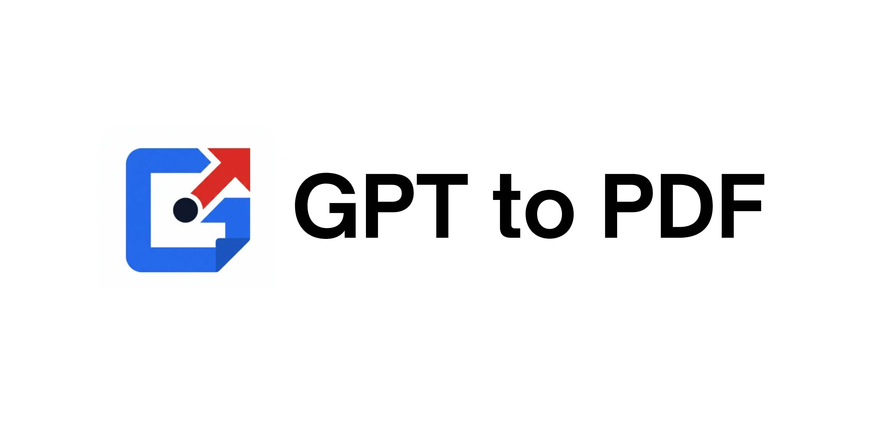
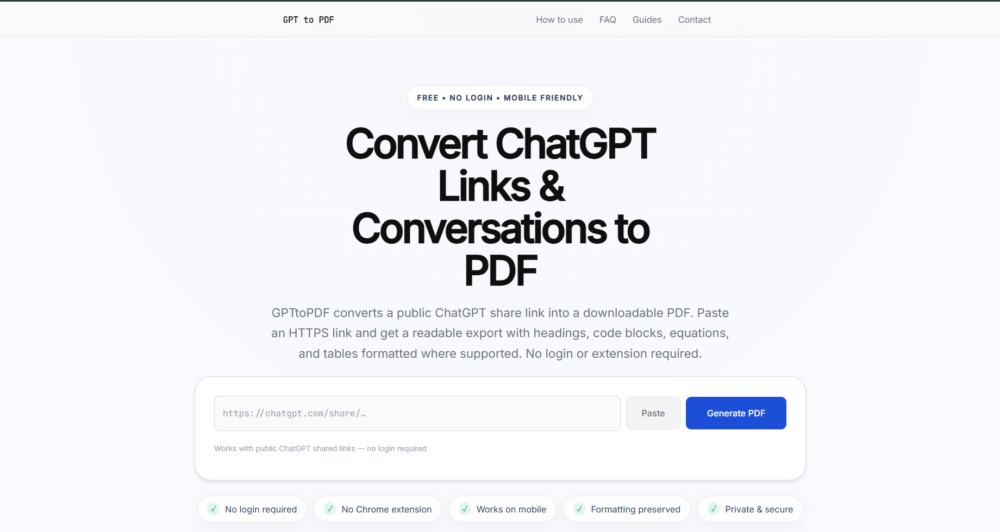
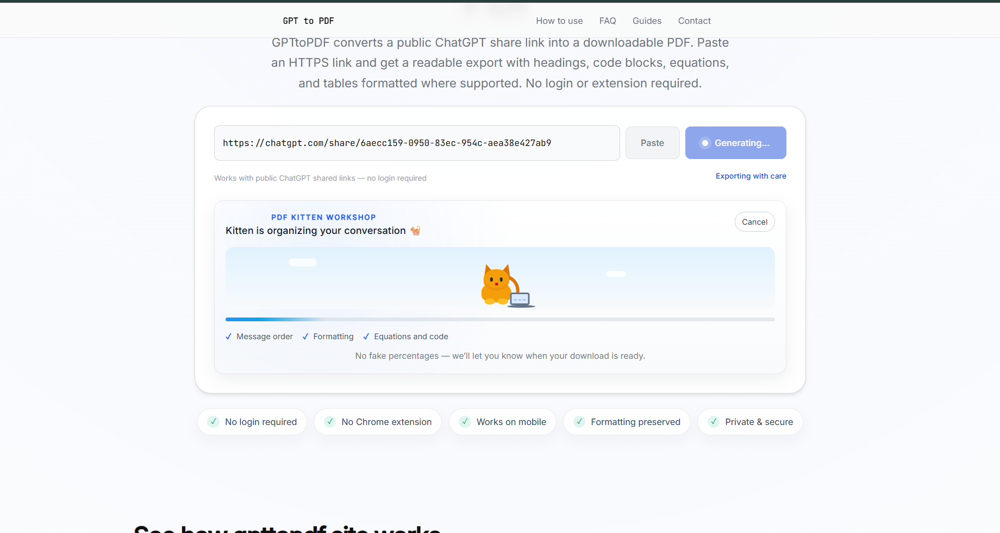

<p align="center">
  
</p>

<h1 align="center">Turn ChatGPT conversations into polished PDFs.</h1>

<p align="center">
  Save and share public ChatGPT conversations as beautifully formatted, downloadable PDFs.
</p>

<p align="center">
  <a href="./LICENSE"></a>
  <a href="./LICENSE"></a>
  
  
  <a href="https://vercel.com"></a>
  <a href="https://www.gpttopdf.site"></a>
</p>

GPT to PDF is an open-source Next.js web app and API that fetches public ChatGPT shared conversations, parses their content, and renders polished PDF exports. No account or browser extension is required.

##  Features

- Convert public ChatGPT shared links into downloadable PDFs.
- Create polished PDFs with considered typography and responsive layouts.
- Render Markdown, code blocks, syntax highlighting, and mathematical notation.
- Work on mobile and desktop, with no login or browser extension required.
- Generate PDFs server-side using headless Chromium for serverless environments.
- Find the project through an SEO-optimized landing page.

##  Tech Stack

| Area | Technologies |
| --- | --- |
| Frontend | Next.js 15 (App Router), TypeScript, Tailwind CSS, shadcn/ui |
| API and PDF generation | Next.js API routes, Puppeteer / puppeteer-core, @sparticuz/chromium |
| Deployment | Vercel (recommended) |

##  Installation

### Prerequisites

- Node.js `>=22.12.0`
- npm (the repository specifies npm `10.8.2`)

### Run locally

1. Clone the repository and enter its directory:

   ```bash
   git clone https://github.com/PrafulCodes/GPT-to-PDF.git
   cd GPT-to-PDF
   ```

2. Install dependencies:

   ```bash
   npm install
   ```

3. Start the development server:

   ```bash
   npm run dev
   ```

4. Open [http://localhost:3000](http://localhost:3000).

### Environment variables

Create a `.env` file or configure these variables in your deployment platform:

- `NEXT_PUBLIC_SITE_URL` — canonical site URL used for SEO and metadata links.
- `VERCEL_URL` — set automatically by Vercel; useful for absolute URLs.

The core public-share conversion flow requires no secret keys. If you add analytics or rate limiting, configure any relevant keys here.

##  Project Structure

```text
apps/web/             # Public Next.js application
  app/                # Pages, layouts, metadata, and API routes
  components/         # Reusable UI components
  lib/                # PDF, parsing, rate-limiting, and request helpers
  public/             # Static assets
  styles/             # Global and page styles
packages/analytics/   # Analytics parsing and test utilities
packages/db/          # Database and Prisma integration
packages/shared/      # Shared TypeScript utilities
scripts/              # Repository utility scripts
docs/                 # Project documentation and content assets
```

This is an npm workspace managed with Turborepo. The public application lives in `apps/web/`; the `packages/` directories contain code shared by the application and database tooling.

##  API Endpoints

### `POST /api/generate-pdf`

- **Request:** JSON body, for example `{ "url": "https://chat.openai.com/share/XXXXXXXX" }`
- **Response:** A streamed PDF (`application/pdf`)

### `GET /api/stats`

Returns basic service stats and telemetry as JSON.

Example local request:

```bash
curl -X POST http://localhost:3000/api/generate-pdf \
  -H "Content-Type: application/json" \
  -d '{"url":"https://chat.openai.com/share/XXXXXXXX"}' --output convo.pdf
```

##  How It Works

1. Paste a public ChatGPT shared URL into the web app.
2. The server fetches the public conversation HTML/JSON.
3. The parser extracts structured hydration data from OpenAI's markup.
4. The server formats the conversation as printable HTML.
5. Puppeteer / Puppeteer-core renders the HTML and generates a PDF.
6. The PDF is streamed back for download.

### Mathematical content

The PDF pipeline renders `$...$`, `$$...$$`, `\(...\)`, and `\[...\]` with KaTeX. Common equation, alignment, gather, cases, and matrix environments are supported. If a shared conversation already contains browser-rendered KaTeX or MathJax, the original TeX annotation is recovered before Markdown conversion so expressions are not discarded.

KaTeX fonts are embedded in the generated document because Puppeteer's `setContent` pages do not have a filesystem base URL for relative font assets.

ChatGPT `:::writing{...}` wrappers are removed only when they occupy a complete standalone line. Literal LaTeX inside Markdown code spans and fenced code blocks is left unchanged.

##  Screenshots

### Landing page



### PDF generation in progress



##  Known Limitations

- Only public ChatGPT shared links are supported. Private chats behind authentication are not accessible.
- Very long conversations can take longer to generate and may hit serverless execution limits.
- HTML parsing relies on OpenAI's client markup; changes to that markup may require parser updates.
- Minor PDF rendering differences may occur between browsers and devices.

##  Roadmap

- Add PDF themes and templates.
- Explore additional export formats, including HTML, Markdown, and DOCX.
- Improve layout and typographic options.
- Add analytics and usage insights.

##  Contributing

Contributions are welcome! GPT to PDF is open source, and community contributions help make it better. Before opening an issue or pull request, please read:

- [Contributors](./contributors.md) — contribution standards and pull request checklist.
- [Contributor development guide](./contributorsguide.md) — setup, testing, branches, commits, and pull requests.

##  License

This project is distributed under the **Praful Attribution License (PAL)**. See [`LICENSE`](./LICENSE) for the complete terms.

##  Author

Created by **Praful Mohite**.

- GitHub: [PrafulCodes](https://github.com/PrafulCodes)
- Website: [gpttopdf.site](https://www.gpttopdf.site)

##  Implementation Notes

- Uses `puppeteer-core` and `@sparticuz/chromium` for headless Chrome compatible with Vercel serverless.
- The parser uses heuristics because OpenAI markup can change; error handling is included.
